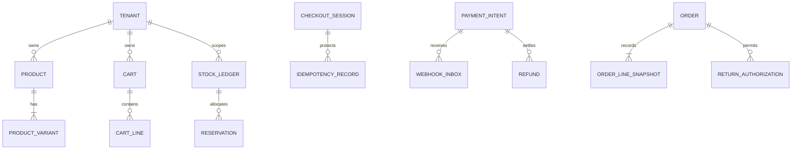

# Northstar Commerce Database Design and ERD

Transactional entity boundaries, tenant keys, constraints, indexes, retention, migration sequencing, and recovery requirements.

## Data ownership and relational model

The operational model separates Tenant, Principal, Product, ProductVariant, Cart, CheckoutSession, PaymentIntent, WebhookInbox, StockLedger, Reservation, Order, Shipment, ReturnAuthorization, Refund, and AuditEvent. Merchant-owned rows carry tenant_id; globally unique IDs do not replace tenant predicates.

## Integrity constraints and indexes

Enforce unique (tenant_id, merchant_sku), unique (tenant_id, idempotency_key_hash, operation), unique (tenant_id, provider_event_id), and foreign keys from child records to tenant-scoped parents. Index tenant_id with status/date for common queries. Use partial indexes for active reservations and unresolved reconciliation records.

## ERD and lifecycle

## Concurrency and consistency

Money is integer minor units. Reservation and coupon redemption use database transactions and unique constraints, not read-then-write checks alone. Webhook inbox insertion and payment state transition commit atomically. Order snapshots are immutable; corrections create compensating entries.

## Retention and privacy

Operational retention follows the security classification standard and applicable fictional pilot policy. Analytics receives masked identifiers and tenant-scoped views. PAN/CVV are prohibited. Audit and financial records have explicit retention owners; deletion requests preserve legally required transaction evidence while minimizing personal data.

## Migration and rollback

Use expand/contract: add nullable columns/tables and indexes concurrently, deploy compatible readers/writers, backfill in bounded batches, verify counts, then remove old fields in a later release. Each migration has a tested down/forward recovery note; destructive data transformations require a backup and explicit sign-off.
